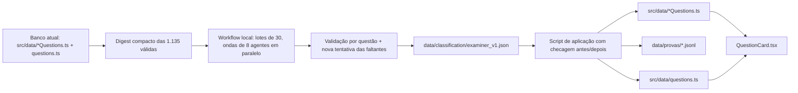

# Fase 1 Multiagente do MedR1 — Análise da Banca e Mapa de Distratores Pré-processados

- **Status:** Implementado (registro de design retroativo para revisão)
- **Data:** 2026-11-27
- **Escopo:** Banco de questões MedR1 (1.174 questões: 1.156 oficiais + 18 curadas)
- **Documentos relacionados:** [GEMINI.md](../GEMINI.md), [005_edugpt_multiagent_tutor.sql](../db/migrations/005_edugpt_multiagent_tutor.sql)

## 1. Problema

Depois de responder uma questão, o aluno do MedR1 hoje vê o gabarito, o comentário geral (`comentarioGeral`) e uma explicação longa por alternativa (`alternativas[].explanation`). Faltam duas coisas:

1. **Uma síntese curta do que a banca quis cobrar.** O comentário geral mistura conceito, conduta e referências em um único parágrafo. O aluno não consegue ver em poucos segundos qual era o conceito central, qual raciocínio leva ao gabarito e qual pegadinha a banca usou.
2. **Uma resposta direta para "por que a minha alternativa está errada".** Quando o aluno erra, a explicação da alternativa escolhida fica escondida atrás de um botão "Ver comentário" e costuma ser longa.

Gerar esse conteúdo sob demanda com um modelo de linguagem durante o estudo traria latência de vários segundos por questão, custo por chamada e dependência de uma chave de API ativa. O projeto também definiu que esta fase não pode usar a API externa do Gemini (`@google/genai`).

## 2. Objetivos

1. Mostrar, para toda questão válida (`anulada !== true`), uma **Análise da Banca** com três partes: conceito central, raciocínio-chave e, quando houver, a armadilha da banca.
2. Mostrar, logo abaixo da alternativa errada que o aluno marcou, **uma frase** explicando por que ela é um distrator.
3. Carregar esse conteúdo junto com a própria questão, sem nenhuma chamada de rede extra no momento do estudo.
4. Manter intactos todos os campos protegidos pelo [GEMINI.md](../GEMINI.md): `id`, `enunciado`, ordem oficial `A–E` das `alternativas`, `gabaritoOficial`, taxonomia v1 (`grandeAreaId`, `grandeArea`, `tema`, `subtema`, `temaSlug`, `subtemaSlug`, `tags`, `taxonomyVersion`), `taxaAcertoBase`, `taxaAcertoGlobal` e `anulada`.
5. Garantir que provas importadas no futuro já cheguem com os dois campos preenchidos.

## 3. Fora do Escopo (Fases Seguintes)

- Diagnóstico automático do tipo de erro do aluno (lacuna conceitual, leitura desatenta etc.) em tempo real.
- Tutor conversacional por questão.
- Geração automática de plano de estudos.

A migration desta fase já cria as colunas e a tabela que essas fases vão usar (`error_category`, `error_diagnosis`, `tutor_feedback`, `study_plans`), mas nenhum código as lê ou escreve ainda.

## 4. Modelo de Dados

Dois campos opcionais novos em `MedicalQuestion` (`src/types/medical.ts`):

```ts
analiseBanca?: {
  conceitoCentral: string;   // 1 frase: tema ou critério clínico cobrado
  raciocinioChave: string;   // 1–2 frases: caminho do enunciado até o gabarito
  armadilhaBanca?: string;   // 1 frase: pegadinha principal, quando existir
};
mapaDistratores?: Record<string, string>; // letra incorreta → motivo objetivo do erro
```

Regras:

- `mapaDistratores` só contém letras que existem em `alternativas` e **nunca** contém a letra do `gabaritoOficial`.
- Questões anuladas não recebem nenhum dos dois campos.
- Os campos são opcionais. Uma questão sem eles continua funcionando como antes; a interface apenas não mostra os blocos novos.

No PostgreSQL, a migration [005_edugpt_multiagent_tutor.sql](../db/migrations/005_edugpt_multiagent_tutor.sql) adiciona `analise_banca JSONB` e `mapa_distratores JSONB` à tabela `questions`.

## 5. Arquitetura



### 5.1 Geração em lote (offline)

1. Um script exporta um **digest** de cada questão válida: `id`, área, tema, subtema, enunciado (até 750 caracteres), gabarito, alternativas com texto (até 260) e explicação existente (até 280), e comentário geral (até 450).
2. Um workflow local (`run_workflow`) divide as 1.135 questões em lotes de 30 e executa ondas de 8 agentes de pesquisa em paralelo. Os agentes recebem apenas o JSON do lote e devolvem `analiseBanca` e `mapaDistratores` para cada questão.
3. Cada resposta passa por um validador que exige:
   - `id` igual ao da questão enviada;
   - `conceitoCentral` com pelo menos 6 caracteres e `raciocinioChave` com pelo menos 12;
   - uma entrada em `mapaDistratores` (com pelo menos 8 caracteres) para **toda** letra incorreta;
   - remoção de prefixos acidentais como "Incorreta.".
   Respostas que falham são descartadas inteiras.
4. Depois das ondas principais, o workflow faz até duas rodadas de nova tentativa, com lotes de 15, apenas para as questões que ficaram sem resultado válido.
5. O resultado é salvo em `data/classification/examiner_v1.json` após cada onda, o que permite retomar o processo de onde parou.

Resultado da execução: 1.134 de 1.135 válidas nas ondas principais e 1.135 de 1.135 após uma nova tentativa.

### 5.2 Aplicação no banco

Um script Python lê `examiner_v1.json` e grava os dois campos em três camadas:

| Camada | Arquivos | Questões válidas atualizadas |
| --- | --- | --- |
| Módulos TypeScript oficiais | 12 × `src/data/*Questions.ts` | 1.118 |
| Fonte JSONL das provas | 12 × `data/provas/*.jsonl` | 1.118 |
| Questões curadas | `src/data/questions.ts` | 17 |

Para cada arquivo, o script tira um "retrato" dos campos protegidos de todas as questões (incluindo a sequência `(letra, texto)` das alternativas) antes e depois da edição. Se os dois retratos forem diferentes, o script para com erro e não grava o arquivo. Se faltar entrada para alguma questão válida, ele também para.

### 5.3 Exibição na interface (`QuestionCard.tsx`)

Seguindo as regras visuais Apple HIG do projeto:

1. **Distrator imediato:** se o aluno errou e existe `mapaDistratores[letraOficial]`, aparece um aviso vermelho translúcido (`bg-[#FF3B30]/10`, texto `#D70015`) logo abaixo da alternativa marcada: "Por que esta alternativa é um distrator: …". A letra usada é sempre a **letra oficial**, então o aviso continua correto quando o embaralhamento visual das alternativas está ligado.
2. **Cartão "Análise da Banca":** na aba de comentário das alternativas, um cartão branco mostra Conceito Central, Raciocínio-Chave e, se existir, Armadilha da Banca (em vermelho, com ícone `AlertTriangle`).
3. **Mapa de distratores:** um botão discreto "Ver mapa de distratores (N)" abre a lista de todas as letras incorretas na ordem oficial do caderno. O estado aberto/fechado volta para fechado ao trocar de questão.

### 5.4 Banco de dados e importação futura

- `server/questionsService.ts` passa a ler `analise_banca` e `mapa_distratores` e os valida antes de devolver: descarta valores que não são objetos, `analiseBanca` sem conceito ou raciocínio, e chaves de `mapaDistratores` fora de `A–E`.
- `server.ts`: o schema de resposta da IA e as instruções de `/api/import/enrich-batch` passam a pedir os dois campos. O formatador de importação descarta a letra do gabarito e letras inexistentes em `mapaDistratores`.
- `merge_and_audit.py` e `export_medr1.py` (pipeline em lote) repassam os dois campos para a saída final, com a mesma filtragem.

## 6. Riscos e Pontos em Aberto

1. **Precisão médica sem revisão humana.** O conteúdo foi gerado por agentes de linguagem a partir das explicações já existentes. O validador confere formato e completude, não correção clínica. Uma frase errada em `mapaDistratores` aparece justamente no momento em que o aluno está mais atento. Não há amostragem de revisão por médico definida.
2. **Contradição com a explicação existente.** A frase de `mapaDistratores` e a `alternativas[].explanation` da mesma letra foram escritas em momentos diferentes e podem discordar. Nenhuma checagem compara as duas.
3. **Digest truncado.** Enunciados acima de 750 caracteres foram cortados no digest. Em questões longas, dados decisivos no fim do enunciado (exames, tempo de evolução) podem não ter chegado ao agente.
4. **Tamanho dos módulos de dados.** Cada questão válida ganhou cerca de 4 a 6 frases. Os módulos `*Questions.ts` são carregados sob demanda por prova, mas o peso de cada prova aumentou e não foi medido.
5. **Auditoria não cobre os novos campos.** `audit_integrity.py` e `merge_and_audit.py --audit-jsonl` não verificam se `analiseBanca`/`mapaDistratores` existem, se coincidem entre `.ts` e `.jsonl`, ou se `mapaDistratores` contém a letra do gabarito. A paridade hoje depende apenas do script de aplicação.
6. **Instruções de geração fora do repositório.** O workflow e o script de aplicação ficaram no diretório temporário da conversa, não em `scripts/` ou `.agents/skills/`. Regenerar ou estender o `examiner_v1.json` exige reescrevê-los.
7. **Colunas sem uso.** `error_category`, `error_diagnosis`, `tutor_feedback` e `study_plans` foram criadas antes de existir código que as use. A lista fixa de categorias de erro em `error_category` pode não servir para a Fase 2.

## Detailed Implementation Plan

### Etapa 1 — Tipos, migration e pipeline

1. `src/types/medical.ts`: adicionar `analiseBanca?` e `mapaDistratores?` em `MedicalQuestion`, logo após `acertosGlobais?`.
2. Criar `db/migrations/005_edugpt_multiagent_tutor.sql`:
   - `ALTER TABLE questions ADD COLUMN IF NOT EXISTS analise_banca JSONB, ADD COLUMN IF NOT EXISTS mapa_distratores JSONB;`
   - `ALTER TABLE question_attempts` com `error_category VARCHAR(60)` (CHECK em 6 valores: `lacuna_conceitual`, `leitura_desatenta`, `distrator_classico`, `confusao_conduta_vs_diagnostico`, `detalhe_epidemiologico_ou_criterio`, `outro`), `error_diagnosis TEXT`, `tutor_feedback JSONB`;
   - índice parcial `idx_question_attempts_student_error_cat` em `(student_id, error_category, answered_at DESC)` para tentativas erradas com categoria;
   - tabela `study_plans` (`student_id`, `title`, `target_exam`, `weekly_hours`, `focus_areas`, `schedule_blocks`, `status`, `generated_by`, `notes`, carimbos de data) + índice `(student_id, status, server_updated_at DESC)` + trigger `set_server_updated_at()` (função já criada em `001_unified_schema.sql`).
3. `server/questionsService.ts`:
   - adicionar `analise_banca?` e `mapa_distratores?` em `QuestionDbRow`;
   - criar `parseAnaliseBanca(raw)` e `parseMapaDistratores(raw)` que devolvem `undefined` para entradas inválidas;
   - incluir `analise_banca, mapa_distratores` nas duas listas `SELECT` (`queryPaginatedQuestions` e `getQuestionById`);
   - em `mapDbRowToMedicalQuestion`, espalhar os campos só quando definidos e só para questões não anuladas.
4. `server.ts`:
   - `QUESTION_ITEM_SCHEMA`: adicionar `analiseBanca` (objeto com `conceitoCentral` e `raciocinioChave` obrigatórios, `armadilhaBanca` opcional) e `mapaDistratores` (objeto com chaves `A`–`E`), sem torná-los obrigatórios no schema;
   - `RawAiQuestion`: adicionar os dois campos;
   - `formatAiQuestionsToMedR1`: normalizar `analiseBanca` e filtrar `mapaDistratores` (somente letras presentes, nunca o gabarito, nunca texto vazio); ignorar ambos em questões anuladas;
   - instrução de `/api/import/enrich-batch`: novo item 7 pedindo os dois campos para questões válidas.
5. `.agents/skills/medr1-batch-pipeline/scripts/merge_and_audit.py`: incluir `analiseBanca` e `mapaDistratores` no objeto `merged` dos dois ramos (falha de enriquecimento → `None` e `{}`; sucesso → valores do enriquecimento).
6. `.agents/skills/medr1-batch-pipeline/scripts/export_medr1.py`: em `build_medr1_question`, antes de `return record`, copiar `analiseBanca` válida e `mapaDistratores` filtrado (letras de `valid_letters`, exceto o gabarito) para questões não anuladas.

### Etapa 2 — Geração em lote

1. Exportar o digest das 1.135 questões válidas para `scratch/valid_questions_digest.json` com `npx tsx` (1.118 dos 12 módulos oficiais + 17 de `MEDICAL_QUESTIONS` em `src/data/questions.ts`).
2. Executar `scratch/generate_examiner_v1_workflow.py` via `run_workflow`:
   - `BATCH_SIZE = 30`, `WAVE_CONCURRENCY = 8`, agentes `research` com modelo `flash`;
   - validar cada item com `validate_entry`; salvar `data/classification/examiner_v1.json` (`version`, `totalProcessed`, `items` ordenados pela ordem do digest) após cada onda;
   - até 2 rodadas de nova tentativa com lotes de 15;
   - critério de saída: `missing = 0`.

### Etapa 3 — Aplicação no banco

1. Executar `scratch/apply_examiner_v1.py`:
   - `*Questions.ts`: localizar o marcador `MedicalQuestion[] = `, interpretar o restante como JSON, aplicar os campos às válidas, comparar retratos antes/depois e regravar com `json.dumps(indent=2, ensure_ascii=False)` + `;`;
   - `*.jsonl`: mesma lógica, uma questão por linha;
   - `questions.ts` (literal TypeScript, não JSON): dividir por blocos `  {\n    id: '…'`, pular blocos com `anulada: true`, remover blocos antigos de `analiseBanca`/`mapaDistratores` se existirem e inserir os novos imediatamente antes de `    comentarioGeral:`.
2. Critério de saída: 1.118 + 1.118 + 17 questões atualizadas e nenhuma exceção de integridade.

### Etapa 4 — Interface

1. `QuestionCard.tsx`: novo estado `showDistractorMap`, reiniciado no `useEffect` de troca de questão.
2. Dentro do bloco `isRevealed` de cada alternativa: aviso de distrator quando `isWrongChosen && !question.anulada && question.mapaDistratores?.[officialLetter]`.
3. No início da aba `commentTab === 'alternativas'`: cartão "Análise da Banca" com botão do mapa de distratores, listando `question.alternativas` (ordem oficial) filtradas para letras diferentes do gabarito que tenham entrada no mapa.

### Etapa 5 — Verificação

Executar em sequência, exigindo código de saída 0:

```bash
python3 .agents/skills/auditor-integridade-medr1/scripts/audit_integrity.py
npx tsx scripts/classify_bank.ts audit
python3 .agents/skills/medr1-batch-pipeline/scripts/merge_and_audit.py --audit-jsonl data/provas --dry-run
npx tsc --noEmit
npm test
```

Resultado registrado: 0 falhas bloqueantes na auditoria de integridade, 1.156/1.156 questões classificadas, 0 erros de taxonomia no JSONL, 0 erros de TypeScript e 164/164 testes em 32 arquivos.
